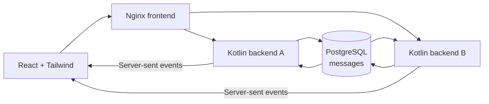

# NAIS Chat

A small, unauthenticated chat application for demonstrating the NAIS platform. A monorepo containing a **Kotlin / Spring Boot backend**, **React / TypeScript / Tailwind CSS frontend**, and PostgreSQL.

Open two browser windows, choose display names, and exchange messages. Each message shows the backend replica that accepted it.



## Run locally

Requirements: Docker with Compose. The container build supplies Node and the JDK.

```sh
docker compose up --build --scale backend=2
```

Open **http://localhost:3000**. The first run downloads images and build dependencies. PostgreSQL uses a persistent named volume; stopping containers preserves history.

```sh
docker compose down
```

For a clean demo, `docker compose down --volumes` deletes local chat history.

## Develop

Requirements: JDK 21, Node.js 22.12+ (or a supported newer Node), and Docker. The Gradle wrapper is included.

```sh
# Start PostgreSQL.
docker compose up -d postgres

# Terminal 1: backend on localhost:8080
./gradlew :backend:bootRun

# Terminal 2: frontend on localhost:5173, proxying /api to the backend
cd frontend
npm ci
npm run dev
```

Default local database credentials are `chat` / `chat`, database `chat`. The backend reads `DB_JDBC_URL`, `DB_USERNAME`, and `DB_PASSWORD`. Defaults match the local infrastructure.

## How delivery works

1. A POST stores the message in PostgreSQL. The response means the transaction has committed.
2. Every backend replica independently polls the latest 100 committed messages every 500 ms and sends new messages to its connected browsers over server-sent events.
3. Each replica remembers the IDs in the current history window. Reading the whole window catches transactions that commit out of order without relying on timestamps as a cursor.
4. Browsers deduplicate by message ID, reload history on connection, and reconcile every ten seconds to cover reconnects and missed live events.

This is a small demo: history and the UI retain the latest 100 messages; the database retains all messages. If more than 100 messages arrive between polls, earlier messages may fall outside the live delivery window. The UI sorts messages by creation time and ID. No rooms, authentication, or application access controls are implemented.

Kafka is deferred until it is available on the platform. The application currently needs only PostgreSQL. The live indicator reflects the browser's event-stream connection; readiness also checks database connectivity.

## Verify

```sh
# Includes Testcontainers integration tests; Docker must be running.
./gradlew :backend:build

cd frontend
npm test
npm run build
```

The backend integration test runs two application instances against real PostgreSQL. It checks delivery to both event streams, persisted history across a restart, removal of the legacy outbox, and rejected invalid messages. Frontend tests check duplicate event handling, message ordering, and the history bound. GitHub Actions runs both suites.

## Deploy to Novari NAIS

The manifests follow the [Novari NAIS documentation](https://docs.novari.cloud.nais.io/). They define a PostgreSQL database, two backend replicas, and a frontend ingress. Only the frontend needs an ingress; it proxies `/api` to the backend. Network policies permit frontend-to-backend traffic. Nginx disables event-stream buffering.

This uses the documented [Postgres resource](https://docs.novari.cloud.nais.io/persistence/postgres/how-to/create), currently an experimental platform feature. The backend uses `READWRITE_PGJDBCURL` for ordinary queries and `PGJDBCURL` for Flyway migrations, following the [workload credentials guidance](https://docs.novari.cloud.nais.io/persistence/postgres/how-to/use-in-workload). The `nais` Spring profile uses the NAIS-provided database credentials. No credentials belong in Git.

The manifests target team `flais` and the frontend ingress configured in `frontend/.nais/app.yaml`.

### Manual deployment

Build and push both images to your permitted registry, then use the NAIS CLI with the intended environment:

```sh
nais apply backend/.nais/postgres.yaml --environment YOUR_ENVIRONMENT --team flais --wait
nais apply backend/.nais/app.yaml --environment YOUR_ENVIRONMENT --team flais --set spec.image=YOUR_BACKEND_IMAGE --wait
nais apply frontend/.nais/app.yaml --environment YOUR_ENVIRONMENT --team flais --set spec.image=YOUR_FRONTEND_IMAGE --wait
```

Flyway applies schema migrations on startup, including removing the legacy outbox table. Existing messages are preserved. All backend replicas use the same database and independently deliver updates to their connected clients.

## Demo ideas

- Open two browser windows and send messages. Observe delivery across replicas.
- Restart a backend pod. Browsers reconnect and history survives.
- Inspect `messages` in PostgreSQL and the backend logs.
- View `/actuator/prometheus` on the internal backend. NAIS scrapes this endpoint. Liveness checks the process; readiness also checks PostgreSQL.

## Repository

| Path | Purpose |
| --- | --- |
| `backend/` | Kotlin Spring Boot API, PostgreSQL polling, Flyway migrations, integration test |
| `frontend/` | React, TypeScript, Tailwind CSS, and Nginx reverse proxy |
| `backend/.nais/` | Backend Application and PostgreSQL manifests |
| `frontend/.nais/` | Frontend Application manifest |
| `scripts/` | Dependency-free manifest renderer |
| `compose.yaml` | Local PostgreSQL, backend, and frontend |
| `.github/workflows/ci.yaml` | Backend and frontend build/test checks |
