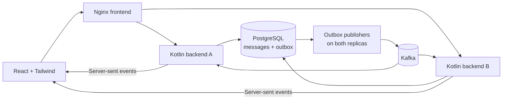

# NAIS Chat

A small, unauthenticated chat application for demonstrating the NAIS platform. A monorepo containing a **Kotlin / Spring Boot backend**, **React / TypeScript / Tailwind CSS frontend**, PostgreSQL, and Kafka.

Open two browser windows, choose display names, and exchange messages. Each message shows the backend replica that accepted it.



## Run locally

Requirements: Docker with Compose. The container build supplies Node and the JDK.

```sh
docker compose up --build --scale backend=2
```

Open **http://localhost:3000**. The first run downloads images and build dependencies. PostgreSQL and Kafka use persistent named volumes; stopping containers preserves history.

```sh
docker compose down
```

For a clean demo, `docker compose down --volumes` deletes local chat history and Kafka data.

## Develop

Requirements: JDK 21, Node.js 22.12+ (or a supported newer Node), and Docker. The Gradle wrapper is included.

```sh
# Start the dependencies and create the Kafka topic.
docker compose up -d postgres kafka kafka-init

# Terminal 1: backend on localhost:8080
./gradlew :backend:bootRun

# Terminal 2: frontend on localhost:5173, proxying /api to the backend
cd frontend
npm ci
npm run dev
```

Default local database credentials are `chat` / `chat`, database `chat`. The backend reads `DB_JDBC_URL`, `DB_USERNAME`, `DB_PASSWORD`, `KAFKA_BROKERS`, and `CHAT_TOPIC`. Defaults match the local infrastructure. Kafka's external listener is `localhost:9092`; containers use `kafka:29092`.

## How delivery works

1. A POST writes the message and an outbox entry in one PostgreSQL transaction. The response means the message is stored.
2. Each backend polls the outbox. `FOR UPDATE SKIP LOCKED` lets replicas share delivery work safely.
3. The publisher waits for Kafka acknowledgement before deleting the outbox row. Failed delivery leaves it for retry.
4. Each backend has its own Kafka consumer group, so **every replica** receives each event and forwards it to its connected browsers over server-sent events. Sharing a consumer group would distribute events between replicas and miss some browsers.
5. Browsers deduplicate by message ID, reload history on connection, and reconcile every ten seconds. This covers reconnects, missed live events, and Kafka downtime.

Delivery is at least once: a crash after Kafka acknowledges but before the database commits can publish the same event again. Multiple publishers may publish messages in a different order; the UI sorts by creation time and ID. History and the UI retain the latest 100 messages; the database retains all messages. No rooms, authentication, or access controls are implemented in the application.

The live indicator reflects the browser's event-stream connection, not Kafka health. PostgreSQL history reconciliation continues while Kafka is unavailable.

## Verify

```sh
# Includes Testcontainers integration tests; Docker must be running.
./gradlew :backend:build

cd frontend
npm test
npm run build
```

The backend integration test runs two application instances against real PostgreSQL and Kafka. It checks delivery to both event streams, persisted history across a restart, outbox completion, and rejected invalid messages. Frontend tests check duplicate event handling, message ordering, and the history bound. GitHub Actions runs both suites.

## Deploy to Novari NAIS

The manifests follow the [Novari NAIS documentation](https://docs.novari.cloud.nais.io/). They define a PostgreSQL database, Kafka topic, two backend replicas, and a frontend ingress. Only the frontend needs an ingress; it proxies `/api` to the backend. Network policies permit frontend-to-backend traffic. Nginx disables event-stream buffering.

This uses the documented [Postgres resource](https://docs.novari.cloud.nais.io/persistence/postgres/how-to/create), currently an experimental platform feature. The backend uses `READWRITE_PGJDBCURL` for ordinary queries and `PGJDBCURL` for Flyway migrations, following the [workload credentials guidance](https://docs.novari.cloud.nais.io/persistence/postgres/how-to/use-in-workload). The `nais` Spring profile enables Kafka TLS using NAIS-provided credential stores. No credentials belong in Git.

**Kafka prerequisite:** the Novari [Kafka pools page](https://docs.novari.cloud.nais.io/persistence/kafka/reference/pools) listed no available tenant pools when this scaffold was created. Confirm that a pool is provisioned for your environment and fill in its name before deploying.

1. Build and push both images to your permitted container registry. Choose immutable tags:

   ```sh
   docker build -f backend/Dockerfile -t YOUR_REGISTRY/nais-chat-backend:YOUR_TAG .
   docker build -f frontend/Dockerfile -t YOUR_REGISTRY/nais-chat-frontend:YOUR_TAG .
   docker push YOUR_REGISTRY/nais-chat-backend:YOUR_TAG
   docker push YOUR_REGISTRY/nais-chat-frontend:YOUR_TAG
   ```

2. Configure the target team/environment in the NAIS CLI. Create the database and wait for it to become ready in Nais Console:

   ```sh
   nais apply backend/.nais/postgres.yaml --environment YOUR_ENVIRONMENT --team flais
   ```

3. Copy each project’s `.nais/vars.example.json` to `.nais/vars.json`, and use the configured `flais` team and fill in the Kafka pool, image references, and an ingress allowed for your tenant. Render each project’s manifests with Python 3:

   ```sh
   cp backend/.nais/vars.example.json backend/.nais/vars.json
   cp frontend/.nais/vars.example.json frontend/.nais/vars.json
   # Edit both vars.json files before rendering.
   python3 scripts/render-manifests.py backend backend/.nais/vars.json
   python3 scripts/render-manifests.py frontend frontend/.nais/vars.json
   ```

4. With kubectl pointing at the intended cluster, apply the backend deployment manifest, which contains both the Kafka Topic and the backend Application. The topic controller provisions the topic and its ACLs asynchronously; allow provisioning to complete before sending demo messages. Then deploy the frontend:

   ```sh
   kubectl apply -f backend/.nais/rendered/app.yaml
   nais apply frontend/.nais/rendered/app.yaml --environment YOUR_ENVIRONMENT --team flais --wait
   kubectl -n flais rollout status deployment/nais-chat-backend
   kubectl -n flais rollout status deployment/nais-chat-frontend
   ```

The Kafka topic's full name is `flais.chat-messages`. The backend deployment manifest uses the same pool variable for its Topic and Application resources. Flyway applies schema migrations on startup. All backend replicas use the same database; consumers use pod-specific groups.

The repository includes CI, Dockerfiles, and deployment templates. Registry publishing and deployment automation need your organization, registry, team, and environment settings; no resources are deployed automatically.

## Demo ideas

- Open two browser windows and send messages. Observe delivery across replicas.
- Restart a backend pod. Browsers reconnect and history survives.
- Temporarily stop Kafka locally with `docker compose stop kafka`. Messages still persist, and the outbox queues delivery. Resume with `docker compose start kafka`; pending events are retried.
- Inspect `messages` and `outbox` in PostgreSQL, Kafka consumer groups, and backend logs.
- View `/actuator/prometheus` on the internal backend. NAIS scrapes this endpoint. Liveness checks the process; readiness also checks PostgreSQL. Kafka outages retain messages for retry rather than failing readiness.

## Repository

| Path | Purpose |
| --- | --- |
| `backend/` | Kotlin Spring Boot API, Kafka consumer, outbox publisher, Flyway migration, integration test |
| `frontend/` | React, TypeScript, Tailwind CSS, and Nginx reverse proxy |
| `backend/.nais/` | Backend Application and Kafka Topic in `app.yaml`, PostgreSQL manifest, deployment variables |
| `frontend/.nais/` | Frontend Application manifest and deployment variables |
| `scripts/` | Dependency-free manifest renderer |
| `compose.yaml` | Local PostgreSQL, Kafka, topic creation, backend, and frontend |
| `.github/workflows/ci.yaml` | Backend and frontend build/test checks |
